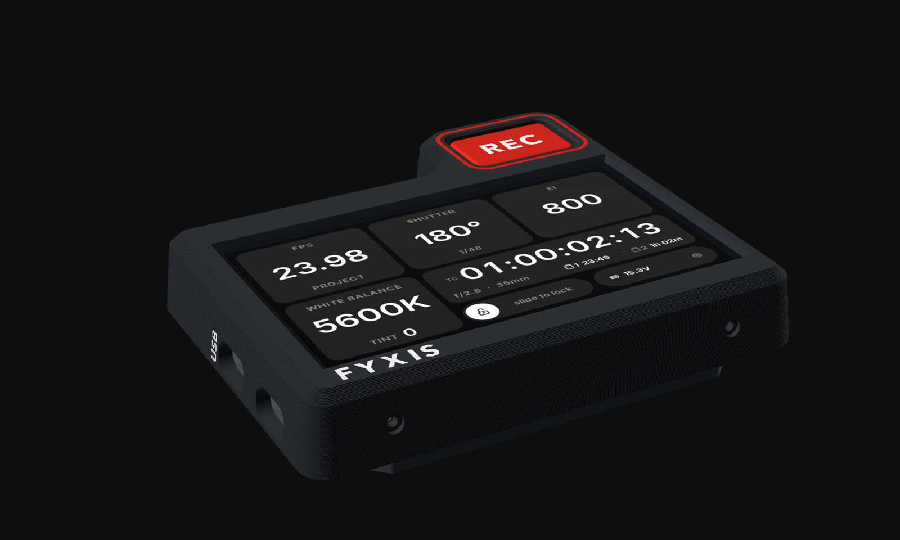
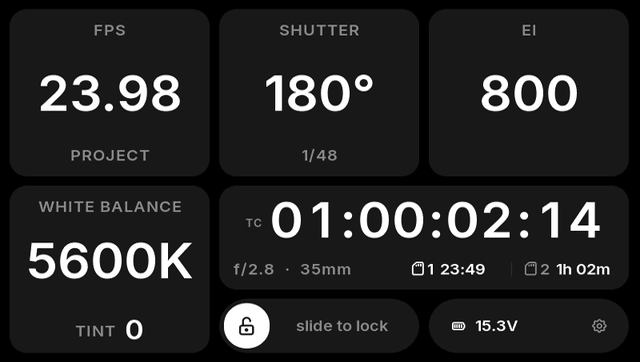
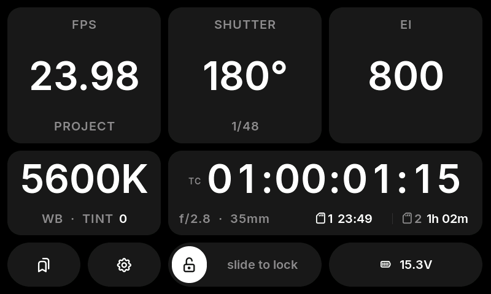
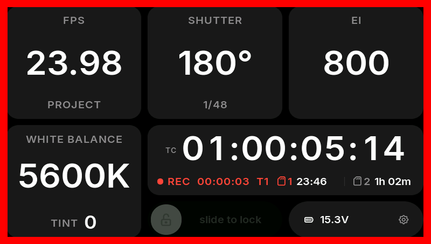
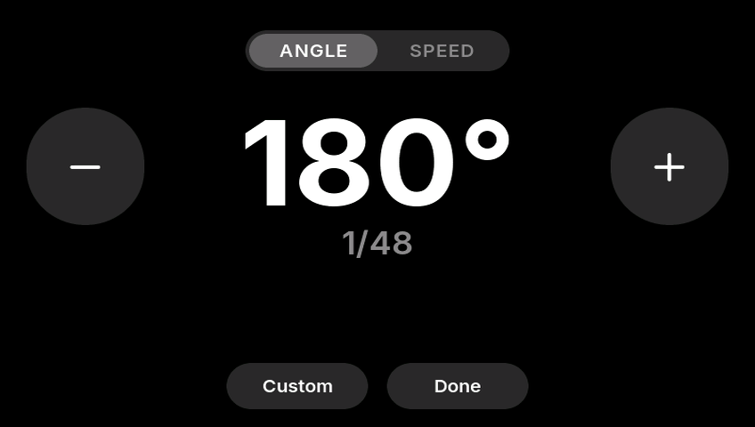
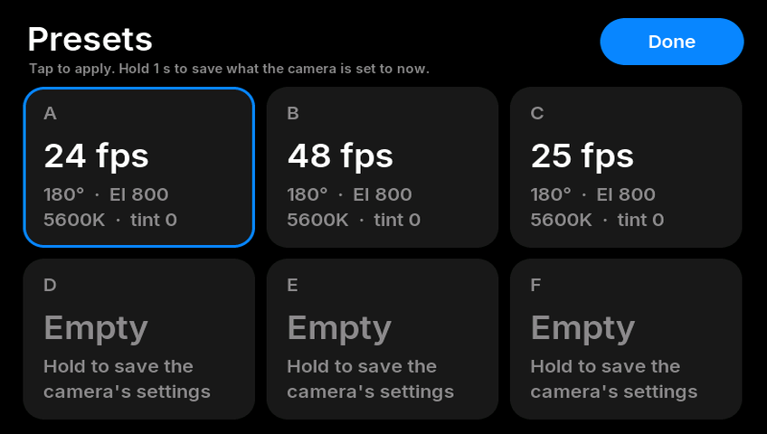
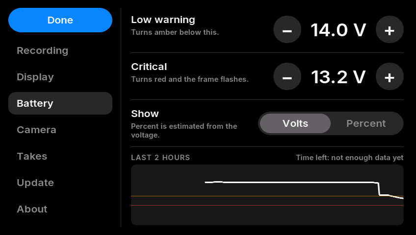
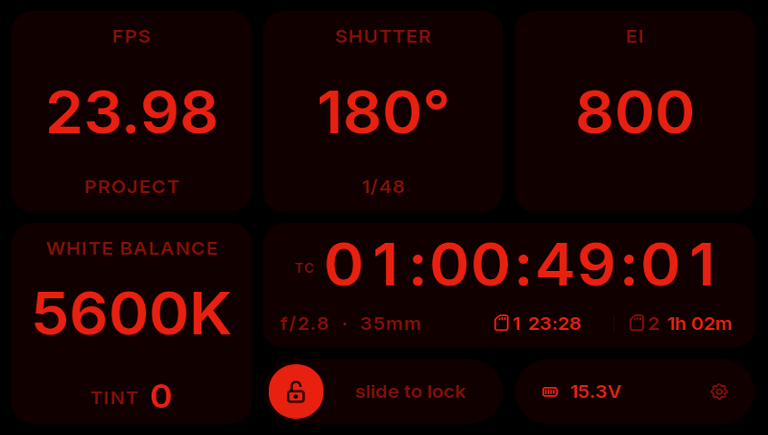

# FYXIS

**A side display and REC button for the Blackmagic PYXIS 12K.** A 4.3" touchscreen in a printed case
on the camera's side plate. It shows the settings you check all day (FPS, shutter, EI, white balance
and tint, timecode, cards and battery) in big type, lets you change them by touch, and adds a real
REC key with a red tally frame round the screen. It talks to the camera over Bluetooth with
Blackmagic's own camera-control protocol, and takes power from the camera's USB-C port. Nothing on the
camera is modified.

*The screen above is the real firmware running in the simulator; the case is a render of the printable model.*

## What it does

- **The big six at a glance:** FPS (with off-speed), shutter angle and speed, EI, white balance and
  tint, in type you can read at arm's length.
- **A timecode you can read across the room**, with both CFexpress cards' remaining time, the sensor
  area, and a clip timer while rolling.
- **A real REC button** on the case, with a red frame round the screen while recording. The frame
  appears the instant you press, dimmed until the camera confirms. Optional "hold to stop" so a knock
  can't end a take.
- **Touch editing:** big − / + buttons, quick off-speed chips (30 · 36 · 48 · 50 · 60 · 72 · 96 · 120),
  angle or 1/x shutter, exact values on a keypad. A slide-to-lock stops accidental changes.
- **Presets:** six one-tap combinations of FPS, shutter, EI and white balance.
- **Take log:** each take's number, start timecode and length.
- **Battery:** the camera's input voltage (or an estimated percentage), time left, warning levels you
  set, and a two-hour graph.
- **Night mode:** an all-red palette for dark sets.
- **Wi-Fi updates:** load new firmware from a phone or computer without taking it off the camera.
- **Lens info:** f-stop and focal length, if the camera reports them.

| | | |
|---|---|---|
|  |  |  |
| Main screen | Recording | Shutter editor |
|  |  |  |
| Presets | Battery settings and graph | Night mode |

## What you need

- A **Waveshare ESP32-S3-Touch-LCD-4.3** (the 800 × 480 version).
- A short **USB-C cable with a right-angle plug** (camera rear port to the board's USB port).
- For the REC key: a **Kailh Choc V2** (MX-stem) switch, a **1 kΩ** resistor, two wires.
- A **3D printer** for the case (PETG or ASA; multi-colour optional), two 1/4"-20 button-head screws,
  four M2 × 5 screws and some thin foam tape.

Full parts list and wiring: [docs/hardware.md](docs/hardware.md).

## Get started

> **Never connect a computer and the camera to the board at the same time.** Flash with the camera
> cable unplugged; plug the camera in only after the computer is disconnected.

1. **Flash the firmware.** Download `fyxis-<version>-full.bin` from
   [Releases](https://github.com/dan-barham/fyxis/releases) and write it at 0x0 with Espressif's web flasher in Chrome. No tools to
   install. Step by step: [docs/building.md](docs/building.md#flashing-no-tools-needed).
2. **Print the case.** Files and settings in [enclosure/](enclosure/README.md).
3. **Wire the REC key** to the board's sensor header: [docs/hardware.md](docs/hardware.md#physical-rec-button).
4. **Mount it** on the PYXIS side plate with the two 1/4"-20 screws, and connect the USB-C cable.
5. **Pair:** turn on Bluetooth in the camera's Setup menu. The camera shows a 6-digit PIN; type it on
   the board. That's the only time you'll need it.

Then read the [user guide](docs/user-guide.md) for everything on the screen and in Settings (tap the
battery strip).

## Documentation

| | |
|---|---|
| [User guide](docs/user-guide.md) | the screen, editors, presets, takes, settings, Wi-Fi updates |
| [Hardware](docs/hardware.md) | parts, how it connects, REC key wiring |
| [Flashing and building](docs/building.md) | web flashing, building with ESP-IDF, the Mac simulator, how it's made fast |
| [Bluetooth protocol](docs/protocol.md) | the camera-control parameters it reads and writes |
| [Enclosure](enclosure/README.md) | printing, hardware, assembly |
| [Changelog](CHANGELOG.md) | |

## Repository

| | |
|---|---|
| `main/` | the firmware's own code: UI (`bigsix.c`), Bluetooth (`camera.c`), protocol (`camproto.c`), REC key, settings, Wi-Fi update |
| `firmware/` | the ESP-IDF project: board set-up, build settings, partition table, a patch for Espressif's display adapter |
| `sim/` | a Mac simulator that runs the same UI and protocol code in a window, against the real camera or a demo |
| `enclosure/` | the OpenSCAD case model, ready-to-print STL/3MF files and a script to re-export them |
| `usb-probe/` | the test firmware that showed USB control isn't possible without extra hardware (the PYXIS is always the USB host) |
| `docs/`, `media/` | documentation, screenshots, renders and the demo video |

## Status

Built for and tested on a PYXIS 12K. Other Blackmagic cameras with the same Bluetooth camera control
(the Pocket and URSA families) will probably mostly work, but haven't been tried. Issues and pull
requests are welcome.

## Licence

Firmware and tools: [MIT](LICENSE). Case design, documentation and media:
[CC BY 4.0](enclosure/LICENSE). Fonts: Inter (SIL OFL 1.1) and Tabler Icons (MIT), see
[licenses/](licenses/).

FYXIS is an independent project by [Dan Barham](https://danbarham.com), a director of photography in
Vancouver. It isn't affiliated with or endorsed by Blackmagic Design. PYXIS is a trademark of
Blackmagic Design Pty. Ltd. Use at your own risk.
