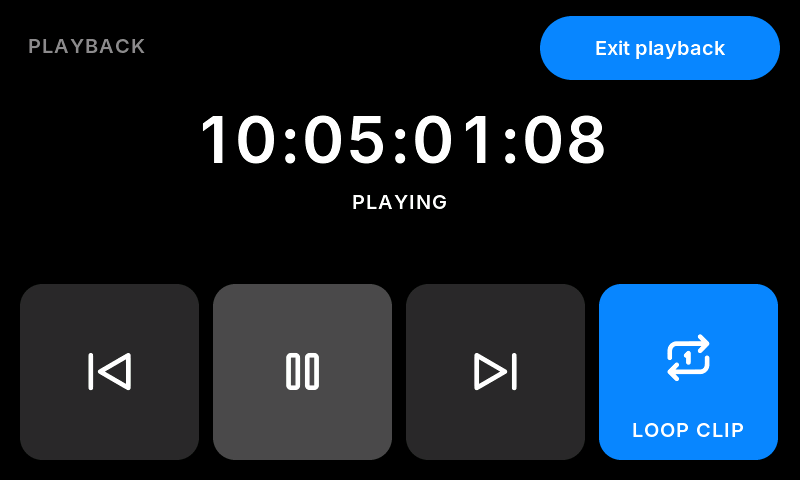

# User guide


```
 FPS                  | SHUTTER              | EI
 5600K                | TC  01:00:12:07                    (two columns wide)
 WB · TINT 0          | 12K 17:9 / REC 00:01:23     1 23:49 | 2 EMPTY
 [presets] [play]     | slide to lock        | battery · settings
```

- **Record:** the physical REC button on the case (wiring in [hardware.md](hardware.md)). It always
  rolls a clip, even while the camera is playing one back.
  While recording: a red frame round the whole screen (nothing moves), editing is blocked, and the
  line under the timecode shows **● REC** and how long the take has been rolling. The frame appears
  dimmed the instant the button is pressed and goes solid when the camera confirms, so a press always
  shows straight away.
- **Editing is unlocked at start-up** (or locked: Settings › Display). To lock it, drag the white knob
  under the timecode to the right (it turns amber); drag it back left to unlock. It stays as you leave
  it. Tapping a tile while locked nudges the knob as a reminder. The track is greyed out while
  recording or not connected.
- **Presets:** the bookmarks button, bottom left. Six cards (A–F); **tap** one to apply its FPS, shutter angle, EI,
  white balance and tint, **hold one for 1 s** to save what the camera is set to now. The card that
  matches the camera has a blue outline. Applying needs editing unlocked and not recording.
- **Takes:** every take whose start the board saw is logged with its number, start timecode and
  length (Settings › Takes; kept until the board restarts). While rolling, the line under the
  timecode shows `REC 00:01:23 T14`; for 8 s after a take it shows `TAKE 14 00:01:23`.
- **Lens:** if the camera reports lens data (an electronic lens), the line under the timecode shows
  `f/2.8 · 35mm` instead of the sensor area, and Settings › Camera shows the lens name. Decoded from
  0.2 (aperture), 0.7 (focal length) and 12.10–12.13 (lens metadata text). Not yet seen from the
  PYXIS: if nothing appears with an EF / L-mount lens, the camera doesn't send it over Bluetooth.
- **Night mode** (Settings › Display › Colours): everything in dim red on black, for dark sets. The
  record frame stays full red.
- **Playback:** the play button, bottom left, puts the camera into playback (paused on the last
  clip) and opens the playback screen; it also opens by itself when you press Play on the camera.
  The clip plays on the camera's screen or its video output, not on this one.
  - **Previous / play-pause / next:** previous and next go to the start of a clip, paused.
  - **Loop** (tap to cycle): **Off** stops at the end of the clip; **Clip** plays the same clip
    again; **All** plays every clip in turn and then starts again from the first. The camera ignores
    its own loop setting over Bluetooth, so the board does it by stepping between clips, and the
    camera's screen shows a brief flash of another frame at each loop.
  - **Exit playback** takes the camera out of playback. The REC button rolls a new clip straight
    from playback and closes the screen.
  - The play button is dimmed while recording or not connected; while editing is locked it only
    nudges the lock knob. The camera only plays clips in its current recording format.

  
- **Exposure lock** (Settings › Camera › Exposure lock › Keep speed): in angle mode the camera keeps
  the shutter *angle* when the frame rate changes, so the shutter *speed* and the brightness change
  with it (24 → 48 fps at 180° is 1/48 → 1/96, a stop darker). With the lock on, the board answers
  every frame-rate change, made on the board or on the camera, with the angle that keeps the speed:
  24 → 48 fps at 180° becomes 360°. Changing the shutter sets a new speed to keep. The shutter tile
  shows `1/48 · LOCKED`. The angle can't go past 360°: then it stays there and the tile turns amber
  with how far short it is (`1/60 · −0.3 STOP`), and going back to a lower rate restores the angle.
  While + or − is held, it waits until the rate stops changing. Presets apply exactly as saved, and
  their shutter speed becomes the one kept. Off by default.
- **Sleep:** after a minute with no camera link (Settings › Display › Sleep: 1 min, 5 min or Never), the
  screen goes black and its backlight off, the panel is refreshed at a quarter of its normal rate, and
  Bluetooth listens for the camera about a tenth of the time instead of all the time. It wakes by
  itself when the camera comes back (Bluetooth on, or the camera switched on), which takes a second or
  two longer than when awake. A touch or the REC key also wakes it; the touch that wakes it doesn't
  press anything. It never sleeps while connected, while the PIN keypad is waiting, or during a Wi-Fi
  update.
- **Tap a tile** while unlocked to open its editor: the value very large, round **−** / **+** buttons
  (hold to repeat), **Done** to close. White balance and tint share one editor.
- **Timecode tile:** the camera's timecode at 64 px. Underneath, on the left: the link state in amber
  when not connected, the clip timer while recording, otherwise the sensor area (`12K 17:9`,
  `8K 3:2`, `4K UHD`). On the right: both CFexpress slots (`1 23:49 | 2 EMPTY`). The card icon is white
  for the slot being recorded to (red while rolling), grey for a second card standing by, dim for an
  empty slot. Card time turns red under 5 minutes; a full card shows **FULL**. Because the camera
  reports an empty slot as 0 time left, a slot counts as holding a card only if its transport flag is
  set or it reports time left (and hasn't been ejected since).
- **Battery strip** (bottom right; tap it for **Settings**): the voltage at the camera's 2-pin LEMO (or
  an estimated percentage) and, once there's 3 minutes of history, an estimate of time left
  (`15.3V · 1h 20m`). The Tilta plate passes the V-mount straight through, so voltage tracks charge;
  it's mapped through a lithium-ion curve anchored on two measured points (15.3 V = 79 %,
  12.8 V = 5 %). The estimate uses how fast that charge figure fell over the last 10 minutes.
  - **Amber** below the low level (default 14.0 V, about 28 %): plan a swap.
  - **Red** below the critical level (default 13.2 V, about 8 %, just before the voltage cliff): the
    screen gets a flashing amber frame; while recording, the red frame alternates red and amber.
  - Both levels are in Settings › Battery. Different packs sag differently, so set them after a few
    real run-downs.
- **FPS editor:** changes the recording frame rate and never touches the project rate.
  - − / + one frame at a time.
  - Quick chips: **OFF · 30 · 36 · 48 · 50 · 60 · 72 · 96 · 120** (OFF = back to the project rate).
  - **Custom:** keypad for any whole frame rate; typing the project rate turns off-speed off.
  - Rates above what the camera allows at the current resolution are refused by the camera.
- **Shutter editor:** an **ANGLE | SPEED** switch at the top.
  - Angle: − / + step through 11.2°, 15°, 22.5°, 30°, 37.5°, 45°, 60°, 72°, 75°, 90°, 108°, 120°, 144°,
    150°, 172.8°, 180°, 216°, 270°, 324°, 360°.
  - Speed: − / + step through 1/24 … 1/5000 in third-stop steps.
  - **Custom:** keypad for an exact angle (up to two decimals) or 1/x speed.
  - Speeds are sent as the matching angle for the current frame rate (the PYXIS works in angle
    mode), so 1/50 at 23.98 becomes 172.63°. The screen shows the speed you asked for.
- Steps: WB 100 K (50 / 100 / 200 K in Settings › Camera), tint 1, ISO 125 … 3200.
- **Pair a different camera:** Settings › Camera › **Forget camera** (tap twice to confirm).

## Settings (tap the battery strip)

| Page | Setting | Choices |
|---|---|---|
| Recording | REC button | **Press** (start / stop) or **Hold to stop** (ending a take needs a 0.5 s hold; starting is still instant) |
| | Record frame | Thick, Thin, Off |
| | Clip timer | On, Off |
| Display | Colours | Normal, Night (all dim red) |
| | Orientation | USB at rear (screen turned 180°), USB at front. The board restarts to apply it |
| | At start-up | Unlocked, Locked |
| | Sleep | **1 min**, 5 min, Never: screen off and slow Bluetooth scanning after this long with no camera |
| Battery | Low warning / Critical | 11.5–16.5 V in 0.1 V steps (critical stays at least 0.2 V below low) |
| | Show | Volts, Percent |
| | (graph) | the last 2 hours of battery voltage with the two warning levels, and the time-left estimate |
| Camera | | camera name, signal and lens; white balance step; **Exposure lock** (Off, Keep speed); **Forget camera** |
| Takes | | the take log (newest first) and **Clear list** |
| Update | | **Wi-Fi update** (see below) |
| About | | firmware, Bluetooth link timing, timecode updates per second, display frame rate and time per frame, free memory, time running; **Reset settings** |

Settings opens only while not recording, and closes if recording starts. Settings and presets are saved in the board's flash (NVS, namespace `bigsix`) a moment after the last
change. Settings saved by an older version are kept; new settings start at their defaults.

## Wi-Fi update (no cables)

Settings › Update › **Start**. The board starts its own Wi-Fi network and shows its name
(`FYXIS-xxxx`), a password made up for this session, and an address. On a phone or Mac: join that
network, open `http://192.168.4.1`, choose the update file and **Upload**: `fyxis-<version>-update.bin` from the
[Releases page](https://github.com/dan-barham/fyxis/releases), or `firmware/build/pyxis_bigsix.bin` if you built it yourself. Or from a
terminal: `curl --data-binary @fyxis-2.1-update.bin http://192.168.4.1/update`. The board
writes it to the app slot that isn't running and restarts into it. If the new firmware resets
within its first 10 s, the bootloader goes back to the old one. Wi-Fi only runs while the Update
page is started; Bluetooth to the camera stays up. The board stays on the camera throughout, so the
two-cables problem (see the warning in hardware.md) never comes up.

## Round shapes

The panel's 800 × 480 pixels cover 95.04 × 53.86 mm, so each pixel is about 6 % wider than it is tall
and anything drawn with equal width and height looks like a wide oval. Round things (the lock knob,
the round buttons, the record dot) are drawn 6 % narrower (`rw()` in `main/bigsix.c`) so they look
round on the panel; in the simulator they look slightly narrow. Text and pill ends aren't corrected.

## First power-up checklist

1. **Board on the bench (powered from a computer via UART, camera cable unplugged):** amber **SEARCHING** under the timecode.
2. **Camera Bluetooth on (Setup menu), camera nearby:** **CONNECTING**, then the PIN keypad appears.
   Enter the PIN from the camera's screen.
3. **Values appear in white** within a second or two. Compare every tile with the camera's own screen,
   including after changing project rate, toggling off-speed, and changing WB/tint.
4. **Touch control:** change ISO, confirm the camera follows. Start recording with the REC button: red
   border, editing blocked, clip timer running.
5. **Reconnect:** turn the camera's Bluetooth off and on (or power-cycle the board). It should come back
   with no PIN prompt.
6. **On the camera:** unplug the computer, then plug the board into the camera's rear USB-C. It powers up from the camera alone.
7. **REC button (if fitted):** press → recording starts and the screen shows the red frame; press again
   → stops. Pressing while not connected does nothing.

## Brightness

Waveshare's wiki says this panel's backlight is **on/off only — it can't be dimmed**.
The UI is mostly black to keep spill down; for night work, plan for a strip of ND gel
or a hood in the enclosure.
