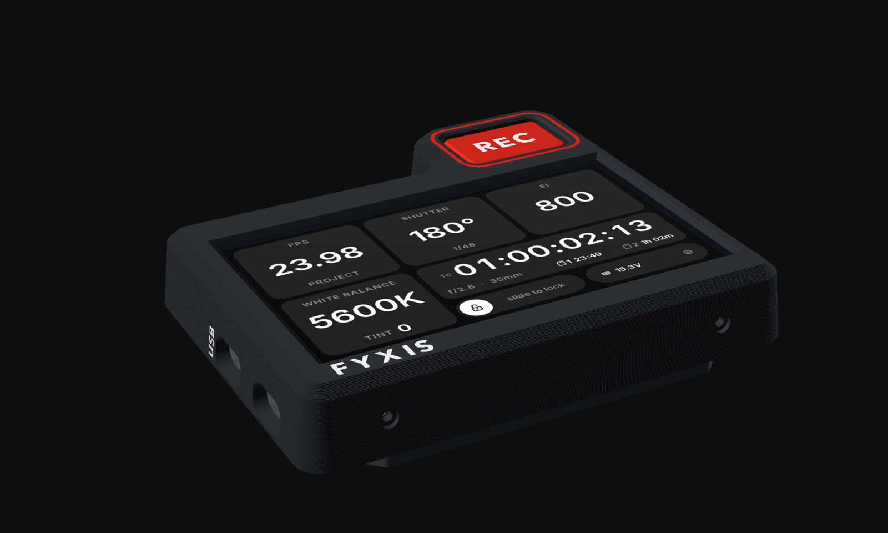
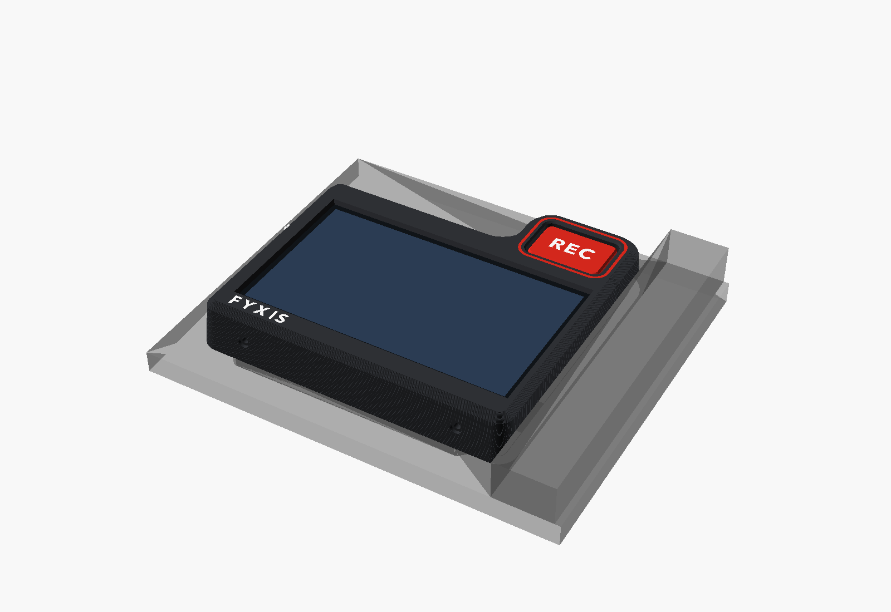

# FYXIS enclosure (version 3)

Licensed CC BY 4.0 (see `LICENSE` in this folder).

A two-part printed case that holds the Waveshare ESP32-S3-Touch-LCD-4.3 on the PYXIS side plate,
with a recessed REC key in a tab at the top front corner. It bolts into the side plate's two
1/4"-20 holes, and a boss on the back drops into the plate's pocket, so it can't shift or twist. The
board's USB-C ports face the back of the camera (matches the firmware's 180° screen flip).





**Size:** 113.7 × 82.1 mm, or 103.3 mm tall at the key tab. It stands 17.6 mm proud of the side plate, plus a 2.8 mm boss in the pocket.

**Position, measured from the 1/4"-20 holes:**
- The front end stops 1 mm short of the NATO rail.
- The rear end is 7.8 mm short of the obstruction behind. The USB-C plugs come out there, so use a right-angle plug.
- Apart from the key tab, the whole case stays below the pocket's top edge, so the camera's top plate is clear.
- The key tab rises 19.8 mm above the pocket.

## Design

- **Cap:** a one-piece sculpted front. The sides lean in 6° toward the face, and a 45° chamfer runs round the face edge.
  - The face has no screws. The cap slides over the tray, and four M2 button heads go in through its top and bottom edges into the tray's side rails.
- **Tray:** a slim back that carries everything structural:
  - the locating boss, sized to the 83.5 mm pocket;
  - the 1/4"-20 slots (±3 mm) with flat counterbores for button heads;
  - sockets for the board's own 4 mm corner posts;
  - a window through the floor under the sensor header, for the flat-soldered REC lead;
  - a window under the switch pins.
- **Depth:** the PCB's back face sits 6.5 mm off the side plate. The 1/4"-20 heads finish at 2.2 mm, below the board's 4 mm parts. The glass is held against the cap's lip by thin foam tape.
- **Key:** 26 × 17 mm, recessed 0.8 mm below the face in a well. The switch plate is sunk inside the case.
- **Multi-material inlays (AMS):**
  - "REC" in white on a red key;
  - a red ring round the key well;
  - "FYXIS" in white under the screen;
  - "USB" in white on the rear end, beside the board's USB port.

## Files

| File | Print as |
|---|---|
| `stl/fyxis_cap.3mf` | one object, three parts: cap (slot 1, black), "FYXIS" + "USB" (slot 2, white), key ring (slot 3, red) |
| `stl/fyxis_keycap.3mf` | one object, two parts: key (slot 3, red), "REC" (slot 2, white). MX-style cross stem |
| `stl/fyxis_tray.stl` | single colour (slot 1) |
| `bigsix_enclosure.scad` | the parametric model (OpenSCAD) |
| `make_3mf.py` | re-exports all three files from the model |

**In Bambu Studio:** open the two 3MFs and the tray STL. The cap and the key each come in as a single
object with their inlays already in place as parts, and each part already has its filament slot.
The cap and key print face down, so "FYXIS", the ring and "REC" are on the underside. Tilt the
view to see them, or check the first layers in the sliced preview. Only "USB" shows from above, on
the cap's rear end. If
your AMS has the colours in other slots, change them in the Objects list, or edit `SLOTS` in
`make_3mf.py` and re-export.

Re-export after changing a parameter (needs OpenSCAD on the PATH):

```bash
python3 make_3mf.py
```

The text uses Avenir Next Bold, which is installed on macOS. On another computer, set `font` to one
that's installed there.

## Before printing

- **REC lead:** solder the lead to the sensor header so it lies flat. There's 6.5 mm under the PCB at
  the header (the window goes through to the side plate), so a plug won't fit.
  Wire it as in the main README's REC button section: AD pin through the 1 kΩ resistor to the switch, and the switch to GND.
- **Key height:** set by `key_seat`, the distance from the switch plate's top to the key's underside
  (7.5 mm, for a Kailh Choc V2 switch and the printed key). With a taller switch, raise it so the key
  ends up 0.8 mm below the face.
- **Stem fit:** if the key is loose or tight on the switch's cross, adjust `mx_cross` (arm length,
  arm width) and re-export.
- **Switch pins:** they reach to about 0.2 mm above the side plate, inside the window under the switch.
  Trim them, or bend them sideways after soldering.

## Hardware

| Qty | Part |
|---|---|
| 2 | 1/4"-20 button-head screw, 3/8" long. 1.6 mm of plastic sits under the head, so this gives about 8 mm of thread in the camera. Use 5/16" if the holes are shallower |
| 4 | M2 × 5 button-head screw, thread-forming into the 1.7 mm pilot holes in the rails |
| 1 | strip of 1 mm foam tape (compresses to 0.5 mm) for the glass border |
| 1 | the switch, a 1 kΩ resistor and a short two-wire lead |
| 1 | short USB-C cable with a right-angle plug, camera rear port to the board's USB port |

## Printing

- **Material:** PETG or ASA. PLA softens on a warm camera in the sun.
- **Orientation:** as exported, no supports.
  - Cap: face down, so the inlays and the face come out crisp. The key well cup points up, and its switch plate is a short bridge.
  - Tray: boss down.
  - Key: top down, stem up.
- **Settings:** 0.2 mm layers (the inlays are 0.6 mm deep, so three layers), 4 walls, 25 % infill.
  Key: 0.12–0.16 mm layers so the stem is accurate.

## Assembly

1. Bolt the tray to the side plate: boss into the pocket, two button-head 1/4"-20 screws through the
   slots. Slide it until it sits square, then tighten.
2. Lay the board in face up, with the USB-C ports at the rear and its corner posts in the sockets.
   The flat-soldered REC lead goes down through the window under the header.
3. Put foam tape on the glass's black border along the top and bottom edges.
4. Clip the switch into the plate at the bottom of the cap's key well, from the front, and solder
   the lead to it.
5. Slide the cap over the tray and fit the four M2 screws through its top and bottom edges.
6. Push the key onto the switch.

To take it off: four M2 screws out, lift the cap (the switch lead stays connected), lift the board, unscrew the two 1/4"-20 screws.
